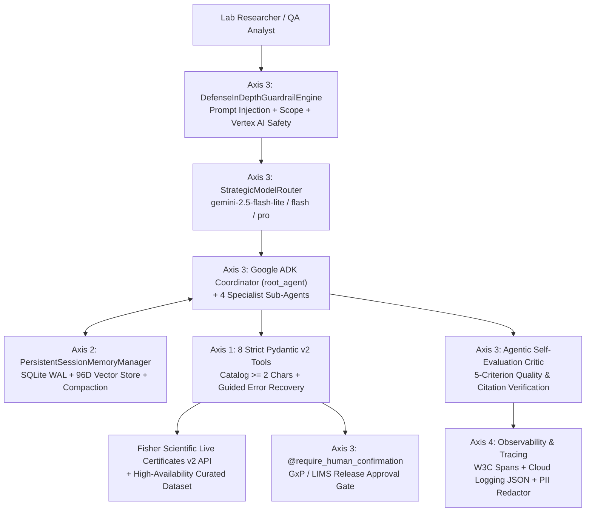

# ThermoFisher / Fisher Scientific Certificate of Analysis (CoA) Chat Agent

An enterprise-grade AI Chat Agent and Interactive Certificate Search Portal engineered to interact with the **ThermoFisher / Fisher Scientific Certificates Portal** (`https://www.fishersci.com/search/documents?type=certificates`).

It enables laboratory researchers, QA/QC analysts, and GxP compliance teams to search for **Certificates of Analysis (CoA)** by:
- **Catalog Number** (*Mandatory, minimum of 2 characters*, e.g., `AC29`, `AC299131000`, `A452-4`, `BP160-500`)
- **Lot Number** (*Optional*, e.g., `A0487095`, `A0487009`, `A0461731`)

And returns the exact 5-column Fisher Scientific Certificates table format alongside analytical purity specifications, lot-to-lot comparisons, and direct PDF download links:

| Lot # | Certificate Type | Date | Catalog Number(s) | Product Name |
| :--- | :--- | :--- | :--- | :--- |
| **`A0487095`** | Certificate of Analysis | Oct 20, 2026 | `AC299131000, AC299130250` | Methanol-d, for NMR, 99.0 atom % D |
| **`A0487009`** | Certificate of Analysis | Oct 20, 2026 | `AC299131000, AC299130250` | Methanol-d, for NMR, 99.0 atom % D |
| **`A0435465`** | Certificate of Analysis | Oct 19, 2026 | `AC295670050, AC295670010` | 2-Ethynylpyridine, 98+% |
| **`A0487208`** | Certificate of Analysis | Oct 19, 2026 | `AC295595000, AC295591000` | Azur eosin methylene-blue, pure, solution according to Giemsa |
| **`A0377651`** | Certificate of Analysis | Oct 19, 2026 | `AC291960250` | 2-Chloro-1H-benzimidazole, 97% |
| **`A0461731`** | Certificate of Analysis | Oct 15, 2026 | `AC295060050, AC295060... View All` | 2-(2-Propynyloxy)tetrahydro-2H-pyran, 98% |
| **`A0470770`** | Certificate of Analysis | Oct 13, 2026 | `AC299305000` | (1,2-Dibromoethyl)benzene, 97% |

---

## Engineered Against the 5-Axis External Rubric



### Axis 1: Tool & Interface Design (`schemas.py`, `tools.py`, `knowledge.py`)
- **Strict Input & Output Schemas**: All 8 tool inputs and outputs inherit from `StrictToolOutputModel` (`ConfigDict(extra="forbid")`) and mirror `TypedDict` definitions in `thermofisher_agent/schemas.py`.
- **Mandatory >= 2 Character Catalog Validation**: Enforces Fisher Scientific's minimum 2-character Catalog Number requirement (`len(catalog_number) >= 2`) and optional alphanumeric Lot Number validation.
- **Guided Error Recovery (`ErrorRecoveryGuidance`)**: Never raises raw unhandled exceptions to the LLM. Invalid inputs (e.g., 1-character catalog `"A"`, empty catalog `""`, invalid lot characters, or unknown certificate types) return structured recovery guidance (`invalid_field`, `error_code`, `corrective_instruction`, `suggested_tool_call`, `valid_examples`) so the agent can self-correct autonomously.
- **Live Fisher Scientific API + Curated Fallback**: Connects directly to `https://www.fishersci.com/api/store/Assets/Documents/Certificates/v2/search` with transparent fallback to `CURATED_CERTIFICATE_ASSETS`.

### Axis 2: Context & Memory (`memory.py`)
- **Persistent SQLite WAL Session Store**: `PersistentSessionMemoryManager` persists multi-turn conversations (`conversation_turns`), structured researcher profiles (`researcher_profiles`: saved catalog numbers, pinned lot numbers, compliance standard), and compacted summaries (`compacted_summaries`).
- **96D Dense Semantic + Character N-Gram Vector Store**: `compute_dense_embedding` indexes every user/agent turn and retrieves semantically relevant past lookups via cosine similarity (`vector_memories`).
- **Automated Context Compaction**: `compact_history_if_needed` automatically summarizes older turns when token thresholds are exceeded while preserving recent raw turns and extracted Catalog/Lot numbers.
- **Native Async I/O**: `aget_comprehensive_session_context` uses `asyncio.gather` to fetch profile state, recent turns, compacted summaries, and vector matches concurrently.

### Axis 3: Orchestration & Logic (`orchestration.py`, `guardrails.py`, `hitl.py`, `agent.py`)
- **Hierarchical Multi-Agent Orchestration**: Google ADK `root_agent` delegates across 4 specialized sub-agents:
  1. `coa_search_specialist` (`gemini-2.5-flash`)
  2. `lot_verification_and_comparison_specialist` (`gemini-2.5-pro`)
  3. `regulatory_and_hitl_specialist` (`gemini-2.5-pro`)
  4. `safety_and_critic_specialist` (`gemini-2.5-flash-lite`)
- **Strategic Model Routing (`StrategicModelRouter`)**: Dynamically routes simple catalog lookups to `gemini-2.5-flash-lite`, standard CoA searches to `gemini-2.5-flash`, and multi-lot comparisons or GxP/USP compliance evaluations to `gemini-2.5-pro`.
- **3-Layer Defense-in-Depth Guardrails (`DefenseInDepthGuardrailEngine`)**:
  - Layer 1: Deterministic prompt injection / jailbreak regex & heuristic blocking + ThermoFisher CoA scope filtering.
  - Layer 2: Cloud-native Vertex AI / Gemini `SafetySetting` declarations.
  - Layer 3: **Agentic Self-Evaluation Critic Loop** scoring every response across 5 criteria (Catalog >=2 char rule compliance, 5-column table accuracy, Lot verification accuracy, scope adherence, and actionable guidance) with automated repair if score < `0.85`.
- **Human-in-the-Loop (`@require_human_confirmation`)**: Pauses high-stakes GxP/LIMS actions (`LIMS_QUALITY_RELEASE_APPROVAL`, `BULK_COA_EXPORT`, `SUBMIT_MISSING_COA_SMARTFORM_REQUEST`, `REGULATORY_AUDIT_PACKAGE_SIGN_OFF`) until an authorized QA reviewer approves or rejects the `confirmation_id`.

### Axis 4: Observability & Tracing (`observability.py`)
- **OpenTelemetry / Cloud Trace Compatible Spans (`DistributedTracer`)**: `@trace_span` decorator records hierarchical `trace_id`, `span_id`, `parent_span_id`, W3C `traceparent` headers, and latency metrics.
- **Cloud Logging Structured JSON (`StructuredJSONLogger`)**: Emits GCP-compatible structured logs with `logging.googleapis.com/trace` correlation.
- **Automated PII & Secret Redaction (`PIIRedactor`)**: Automatically scrubs emails, phone numbers, SSNs, credit cards, and API keys (`AIza...`, `Bearer ...`) before any log or trace span is recorded.
- **Intent-vs-Outcome Drift Tracking (`IntentOutcomeTracker`)**: Classifies user intent (`COA_CATALOG_SEARCH`, `COA_CATALOG_AND_LOT_SEARCH`, `MULTI_LOT_COMPARISON`, `CATALOG_VALIDATION_RECOVERY`, `HIGH_STAKES_REGULATORY_HITL`, `OUT_OF_DOMAIN`) and tracks alignment against actual tool execution outcomes.

### Axis 5: Infrastructure & CI/CD (`secrets.py`, `terraform/`, `Dockerfile`, `cloudbuild.yaml`, `.github/workflows/ci.yml`)
- **Cloud Secret Manager (`SecretManagerService`)**: Resolves `thermofisher-gemini-api-key` from GCP Secret Manager with thread-safe TTL caching and graceful `.env` fallback for local development.
- **Declarative Terraform IaC (`terraform/`)**: Provisions least-privilege Service Account, Secret Manager secret & IAM bindings, Artifact Registry, and Cloud Run v2 with startup/liveness probes.
- **Automated CI/CD & Evaluation Gate**: `cloudbuild.yaml` and `.github/workflows/ci.yml` execute static compilation checks and the full `pytest` 5-axis evaluation suite before building or deploying the container.

---

## Quick Start

### 1. Run the Interactive Web Portal & Chat Agent (FastAPI)
```bash
uvicorn app:app --host 0.0.0.0 --port 8080
```
Open `http://localhost:8080` to use the interactive **Fisher Scientific Certificate of Analysis Search Portal + AI Chat Agent**.

### 2. Run via CLI
```bash
# Search by Catalog Number (minimum 2 characters, e.g., AC29)
python3 -m thermofisher_agent.cli --catalog AC29

# Search by Catalog Number + Optional Lot Number
python3 -m thermofisher_agent.cli --catalog AC29 --lot A0487095

# Compare two manufacturing lots side-by-side
python3 -m thermofisher_agent.cli --compare-lots A0487095 A0461731 --catalog AC29

# Run the comprehensive 5-scenario showcase
python3 -m thermofisher_agent.cli --demo
```

### 3. Run the 5-Axis Evaluation & Unit Test Suite
```bash
pytest -v tests/test_thermofisher_agent.py
```
